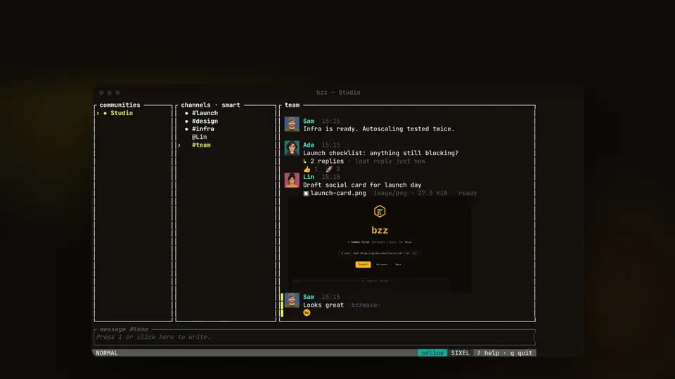

<p align="center">
  
</p>

<h1 align="center">bzz</h1>

<p align="center">
  <strong>A fast, keyboard-driven terminal client for <a href="https://github.com/block/buzz">Buzz</a>.</strong><br>
  Your team chats in Buzz. You live in the terminal. Now you don't have to leave it.
</p>

<p align="center">
  <a href="https://github.com/arpagon/bzz/releases/latest"></a>
  <a href="https://github.com/arpagon/bzz/actions/workflows/ci.yml"></a>
  <a href="#license"></a>
  <a href="https://getbzz.dev"></a>
</p>

<p align="center">
  <a href="https://getbzz.dev/assets/promo-v014.mp4" title="Watch the launch film, with sound">
    
  </a>
  <br>
  <sub>The real bzz binary, recorded in a terminal. <a href="https://getbzz.dev/assets/promo-v014.mp4">Watch the 55-second film with sound</a>.</sub>
</p>

<p align="center">
  <a href="#install">Install</a> ·
  <a href="#get-started">Get started</a> ·
  <a href="#keys">Keys</a> ·
  <a href="docs/release-v0.14.0.md">What's new in 0.14</a> ·
  <a href="docs/README.md">Docs</a>
</p>

## Who it's for

You spend your day in a terminal: an editor, a shell, a coding agent or
three in tmux. Your team, and more and more your agents, talk in Buzz.
Switching to a desktop app for every mention breaks your flow.

bzz puts Buzz in a pane next to your work. It is a single Rust binary
that runs in any terminal, over SSH and offline, and is driven entirely from
the keyboard. It speaks the Buzz protocol directly and is tested against
the real Buzz relay, so your teammates on Buzz desktop and mobile see exactly
what you send.

> **New in 0.14 — the Buzz 1.0 era.** Edit your messages with `e` and see
> everyone's edits. Solo chats and sidebar sections stay in sync with Buzz.
> Pair with Buzz 1.0 so it keeps your key. Names and @mentions follow Buzz
> 1.0's rules. [Release notes](docs/release-v0.14.0.md).

## Why bzz

- **Keyboard first.** Channels, threads, DMs, reactions, edits and search,
  all without leaving the home row. Vim-style motions, a `Space` leader and
  a `?` cheat sheet.
- **Works offline.** History, threads, profiles and drafts live in a local
  SQLite database. Search it with no connection; it fills in from the relay
  when you are back.
- **Feels like Buzz.** Solo chats and your sidebar sections sync with Buzz
  desktop and mobile. Names, @mentions, edits, custom emoji, presence and
  status follow the same rules as Buzz 1.0.
- **Agents, on your terms.** Mention an agent and its reply lands in the
  thread. bzz can also hold keys for your own local agents and let them act
  through it, with per-action permissions you set and can pause.
- **Real media.** Images, avatars and custom emoji render inline in Kitty,
  Sixel and iTerm2 terminals, with a Unicode fallback everywhere else.
  Huddles have real audio.
- **Your keys stay yours.** Keys live in your OS keychain (or an encrypted
  file), never in arguments or environment variables. Or pair bzz with the
  Buzz app and let it keep the key.
- **60 themes**, plus your own in `theme.toml`.

## Install

macOS and Linux:

```sh
curl -fsSL https://getbzz.dev/install.sh | sh
```

Windows (PowerShell):

```powershell
powershell -ExecutionPolicy Bypass -c "irm https://github.com/arpagon/bzz/releases/latest/download/bzz-installer.ps1 | iex"
```

Or download an archive from the
[latest release](https://github.com/arpagon/bzz/releases/latest). Every
release ships SHA-256 checksums, a CycloneDX SBOM and GitHub build
attestations; [`docs/releasing.md`](docs/releasing.md) shows how to verify
them.

From source (Rust 1.98, pinned in `rust-toolchain.toml`):

```sh
cargo install --git https://github.com/arpagon/bzz --locked
```

## Get started

Create an identity, add your community and open bzz:

```sh
bzz identity new --label personal
bzz identity list                      # shows the identity's id
bzz community add my-team wss://my-team.communities.buzz.xyz <identity-id>
bzz
```

Back up your key once, to a password-encrypted file:

```sh
bzz identity backup <identity-id> --output ~/bzz-identity.ncryptsec
```

Already have a Buzz key? `bzz identity import` reads it from the terminal.
No credential store on this machine? Add `--backend encrypted-file`.

### Using bzz next to the Buzz app

You don't have to choose. To use the identity you already have in Buzz
(desktop 0.X or Buzz 1.0) without copying its key, pair bzz with the
running app:

```sh
bzz identity pair-desktop --label buzz --relay wss://my-team.communities.buzz.xyz
```

Approve the request in Buzz. The key stays in Buzz, so Buzz must be open
while you use bzz. Buzz signs everyday work for other apps (messages, edits,
reactions, status), but not deleting, reporting, huddles, channels or profile
changes; bzz tells you before you try. To do everything from bzz, import the
key instead. Pairing is not available on Windows.

## Keys

Press `?` in bzz for the complete, current list.

| Key | Action |
|---|---|
| `j` `k` · `gg` `G` | Move down, up · jump to top, bottom |
| `1`–`4` · `Tab` · `h` `l` | Focus communities, channels, conversation, context |
| `Space` `Space` | Jump to any channel or DM |
| `Enter` | Open the selected thread |
| `i` | Write (`Enter` sends, `Ctrl-j` adds a line) |
| `@` | Mention someone; `Space` completes a unique name, `Tab` picks |
| `r` · `e` | React · edit your own message |
| `/` | Search (`from:` `in:` `after:` `before:`; `Ctrl-o` loads older) |
| `Space n` | Inbox: mentions, threads, DMs and drafts |
| `Space a` | Every action for the selected item |
| `Space o` | Themes |
| `y` · `v` | Copy a message · select a range to copy |
| `Ctrl-o` · `Ctrl-v` (writing) | Attach a file · paste a file, image or text |
| `:` | Commands (below) |
| `q` | Back, then quit |

## Commands

| Command | Does |
|---|---|
| `:solo <name>` | Start a Solo chat |
| `:section new <name>` | Put the selected channel in a new sidebar section; also `rename`, `delete`, `move <name>`, `remove`, `up`, `down` |
| `:sort alpha\|recent\|default` | Sort the selected channel's sidebar group |
| `:dm` · `:dm add` · `:dm hide` | New direct message · add someone · hide it |
| `:inbox` · `:search` · `:agents` | Inbox · search · agents in this community |
| `:huddle start\|join\|leave\|end\|mute` | Huddles with audio |
| `:status <text>` · `:presence on\|off` | Your status · publish your presence (off by default) |
| `:profile` | The selected author's profile and verified identity |
| `:artifacts` · `:tasks` | Channel artifacts · tasks assigned to you |
| `:report <reason>` · `:tochannel` | Report a message · send a thread reply to the channel |
| `:broker` | Your local agents: permissions, activity, pause |
| `:signin` | Sign in to a community that requires federated identity |
| `:system` | Show or hide System channels |
| `:reconnect` · `:resync` · `:lock` | Recover the connection · reload history · lock the identity |

Outside the TUI, `bzz --help` lists everything: identities, communities,
themes, media cache, local agents (`bzz broker`), diagnostics and shell
completions.

## Privacy and security

- Keys are stored in the OS keychain or a passphrase-encrypted file, and
  never accepted as arguments or environment variables.
- bzz publishes nothing about your activity (presence, typing) unless you
  turn it on.
- Message media is fetched only from your community's relay, verified by
  size, type and SHA-256, and never executed; links in messages stay inert.
  Profile pictures load over credential-free HTTPS, and can be turned off
  (`ui.profile_avatars = "off"`).
- Diagnostics are local, content-free and owner-only. Telemetry is off unless
  you configure it.
- Workspace DMs are private relay channels, **not** end-to-end encrypted.

Details: [`docs/security.md`](docs/security.md).

## Compatibility

bzz follows the Buzz protocol and is tested against a pinned `block/buzz`
relay revision; the revision and every supported surface are listed in
[`docs/protocol-compatibility.md`](docs/protocol-compatibility.md). It runs on
Linux, macOS (Intel and Apple Silicon) and Windows. Huddle audio on Windows
is experimental.

## Documentation

- [Configuration](docs/configuration.md) · [Themes](docs/themes.md) ·
  [Media and terminal graphics](docs/media.md) ·
  [Inbox, DMs and search](docs/inbox-dms-search.md)
- [Troubleshooting](docs/troubleshooting.md) · [Security](docs/security.md)
- [All documentation](docs/README.md): release notes, validation records,
  plans and design decisions for every version.

## Development

```sh
cargo build --locked
cargo test --locked
cargo fmt --check && cargo clippy --locked --all-targets --all-features -- -D warnings
cargo deny check && cargo audit
```

`--no-default-features` builds without huddle audio. Debug builds use
separate `bzz-dev` paths and keychain entries, so they never touch your real
identity.

Integration tests against a real Buzz relay start Docker services and are
opt-in:

```sh
BZZ_BUZZ_SOURCE=/path/to/block/buzz ./scripts/test-relay.sh            # also --nip-fi
BZZ_HERDR_PANE=<pane> ./scripts/test-relay.sh --herdr                  # drives the release TUI
```

How changes are proven before release: [`.agents/skills/bzz-prove-it-works`](.agents/skills/bzz-prove-it-works/SKILL.md).

## License

MIT OR Apache-2.0, at your option. See [`LICENSE-MIT`](LICENSE-MIT),
[`LICENSE-APACHE`](LICENSE-APACHE) and
[`THIRD_PARTY_LICENSES.md`](THIRD_PARTY_LICENSES.md).

bzz is an independent open-source project compatible with the Buzz protocol.
It is not affiliated with, endorsed by, or sponsored by Block, Inc.
